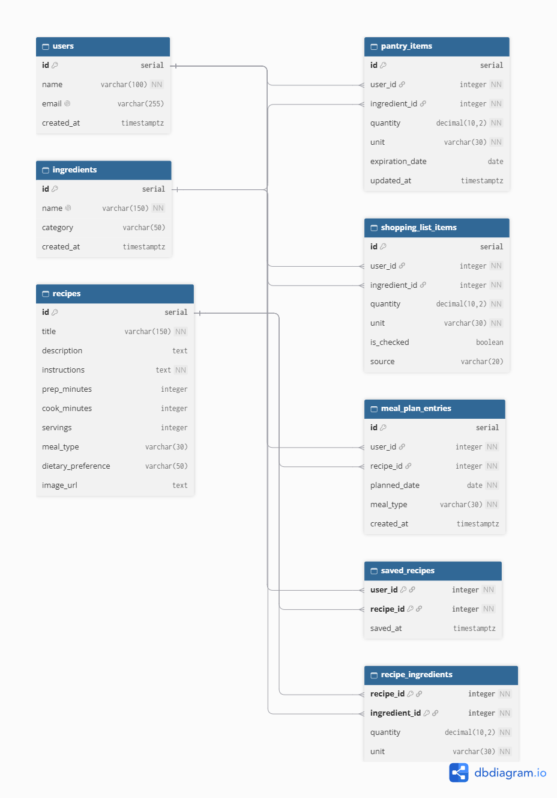

# PrepWise — Entity Relationship Diagram

## Database Overview

PrepWise uses PostgreSQL to manage pantry inventories, recipes, ingredients, weekly meal plans, saved recipes, and shopping lists.

## List of Tables

1. `users` — Stores user information.
2. `ingredients` — Stores available ingredients.
3. `pantry_items` — Tracks ingredients in each user's pantry.
4. `recipes` — Stores recipes and preparation instructions.
5. `recipe_ingredients` — Connects recipes and ingredients.
6. `meal_plan_entries` — Stores scheduled meals.
7. `saved_recipes` — Tracks bookmarked recipes.
8. `shopping_list_items` — Stores grocery items.

## Database Relationships

### One-to-Many
- Users → Pantry Items
- Users → Meal Plan Entries
- Users → Shopping List Items

### Many-to-Many
- Recipes ↔ Ingredients (through `recipe_ingredients`)
- Users ↔ Recipes (through `saved_recipes`)

## Entity Relationship Diagram

## ERD Video Explanation

[Watch our PrepWise ERD Explanation](assets/Entity_Explanation.mp4)

## Editable Diagram Source

The original DBML schema is available in `assets/prepwise-erd.dbml` and can be imported into dbdiagram.io for future modifications.