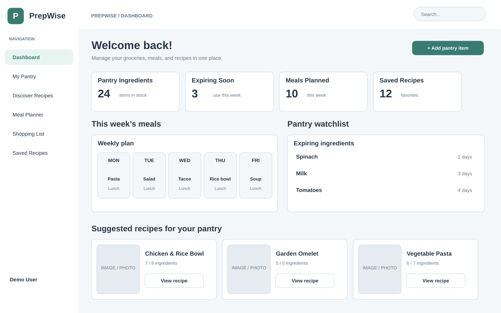
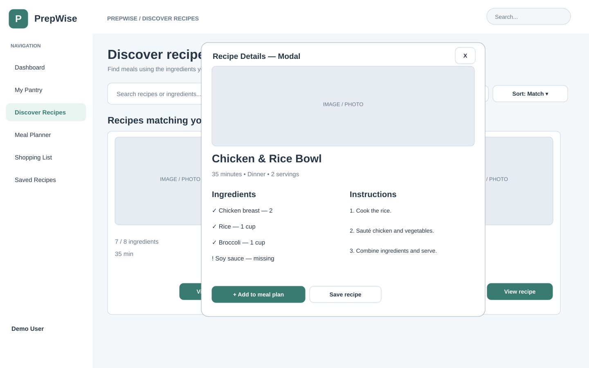
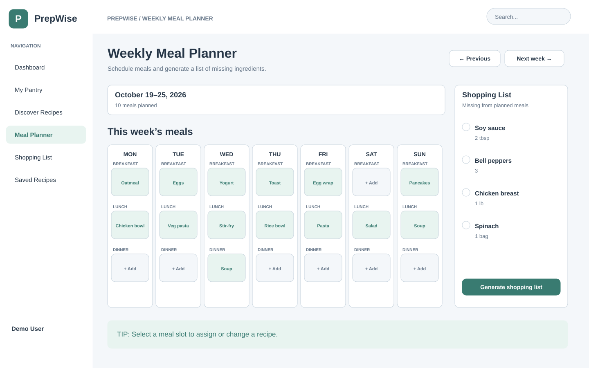

# PrepWise — Wireframes

## List of Pages

- ⭐ Dashboard
- My Pantry
- ⭐ Discover Recipes
- ⭐ Weekly Meal Planner
- Shopping List
- Saved Recipes

⭐ = Pages with completed wireframes.

## Wireframe 1: Dashboard

The Dashboard provides an overview of pantry ingredients, upcoming meals, expiring ingredients, and recommended recipes.

## Wireframe 2: Discover Recipes

Users can search, filter, and sort recipes based on available ingredients, preparation time, and dietary preferences. A recipe detail modal displays ingredients and cooking instructions.

## Wireframe 3: Weekly Meal Planner

Users can organize their meals throughout the week, assign recipes to specific days, and generate shopping lists based on missing ingredients.
